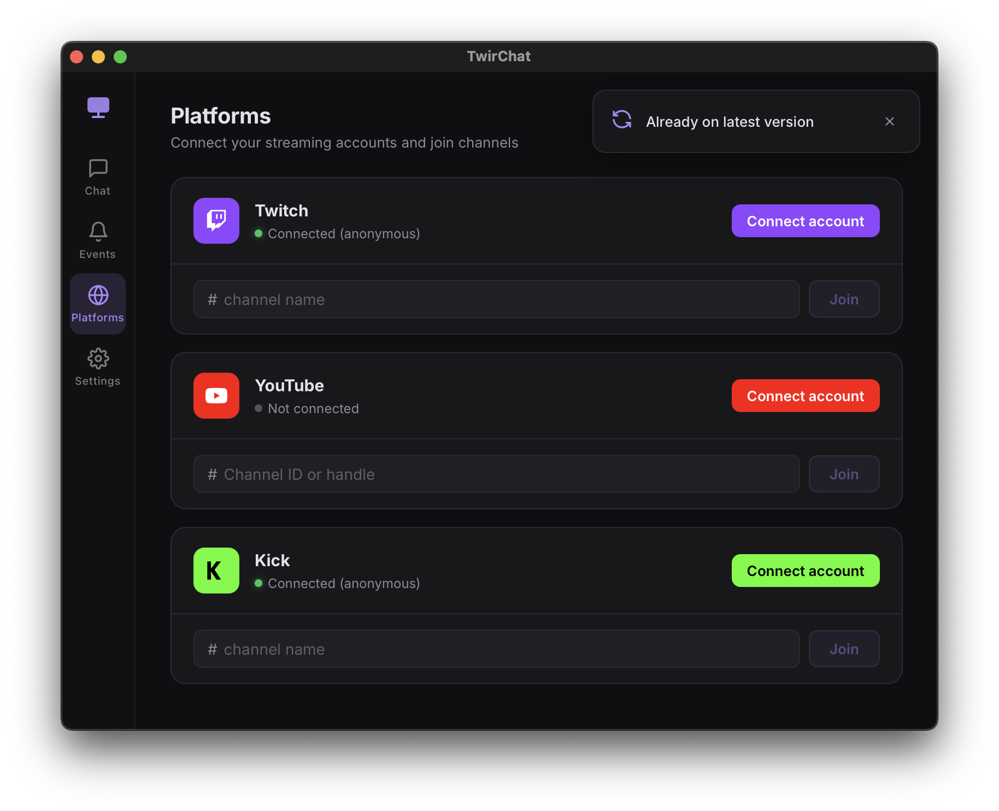

# TwirChat

Multi-platform chat manager for streamers (Twitch, YouTube, Kick).




## Installation

Desktop releases are published from stable `vX.Y.Z` tags. Builds are available for Linux x64,
Windows x64, and macOS Apple Silicon and Intel. Current installers are unsigned; macOS builds
are not notarized. Download the matching installer and `SHA256SUMS` from
[Releases](https://github.com/Satont/twirchat/releases/latest).

### Linux

Download the Linux x64 `.AppImage` and verify its checksum before launching it:

```bash
sha256sum --check --ignore-missing SHA256SUMS &&
  chmod +x ./*linux-x64*.AppImage &&
  ./*linux-x64*.AppImage
```

Alternatively, download and inspect [the Linux installation script](scripts/install-linux.sh),
then run `bash install-linux.sh`. It requires `curl`, `jq`, and `sha256sum`, checks the CPU and
installer checksum, and adds an application menu entry and `~/.local/bin/twirchat`.

Linux requires glibc 2.35 or newer and a working Vulkan driver. Keep the AppImage in a writable
directory to allow updates. FUSE 2 is required to mount AppImages on systems that do not provide
an AppImage integration service.

### Windows

1. Download the latest Windows Velopack Setup `.exe` from
   [Releases](https://github.com/Satont/twirchat/releases/latest).
2. Run the installer to install TwirChat.

### macOS

1. Download the macOS installer or application archive for Apple Silicon or Intel from
   [Releases](https://github.com/Satont/twirchat/releases/latest).
2. Install `TwirChat.app`. macOS 13 or newer is required.

## Updates

Packaged desktop builds initialize Velopack at startup, check their architecture-specific feed while
automatic checks are enabled, show an in-app update toast when a stable update is available, and
can download the update before restarting to apply it.

Users of the previous distribution should install the new GPUIX package manually once because
the old release feeds are being retired. Preserve the `~/.twirchat` profile before reinstalling.

## Plugins

Install and manage local TypeScript extensions in **Settings → Plugins**. See the
[plugin guide](docs/plugins.md) for commands, chat events and third-party channel transports.

## Image uploads

Set up **Settings → Chat → Image Uploader** to paste screenshots and other copied images
into the chat input with **Ctrl+V** (**Cmd+V** on macOS). Enable uploads, enter your image
host's multipart POST endpoint and file field, then save. You can import an existing
Chatterino, Leafyrino or compatible ShareX configuration from the clipboard.

Use `Authorization: Bearer TOKEN; X-Custom: value` for extra headers, or put each header
on its own line. Leave **Image link** blank if the server replies with a plain URL, or use
a JSON template such as `{data.images.0.url}`. **Deletion link** accepts the same syntax.

TwirChat asks before uploading by default. The returned image link is inserted at the
composer's caret; send the draft when you're ready. Copy an optional deletion link from
the upload result in the composer.

## Release and backend delivery

Pull requests validate types, lint, formatting, tests, native desktop packages and backend Docker
builds. Stable version tags build all platforms before publishing a complete GitHub release and
versioned backend images at `ghcr.io/satont/twirchat/backend`.

See [the release guide](docs/releasing.md) for release commands, update channels, signing status,
checksums, production Compose configuration, database backups and rollback.

To run the production backend and PostgreSQL from the repository root:

```bash
cp .env.production.example .env
# Fill in OAuth credentials, database credentials and public HTTPS URLs in .env.
docker compose up -d
```

The default backend image is `1.0.0`; set `TWIRCHAT_VERSION` in `.env` to select a release.
The backend binds to `127.0.0.1:3000`, and PostgreSQL has no host port. Put an HTTPS reverse
proxy with WebSocket support in front of the backend for public access.

## Development benchmarks

The [chat resource benchmark guide](docs/benchmarks/README.md) covers CPU, GPU and memory runs,
with the saved baseline and commands for repeating the isolated native benchmark.
