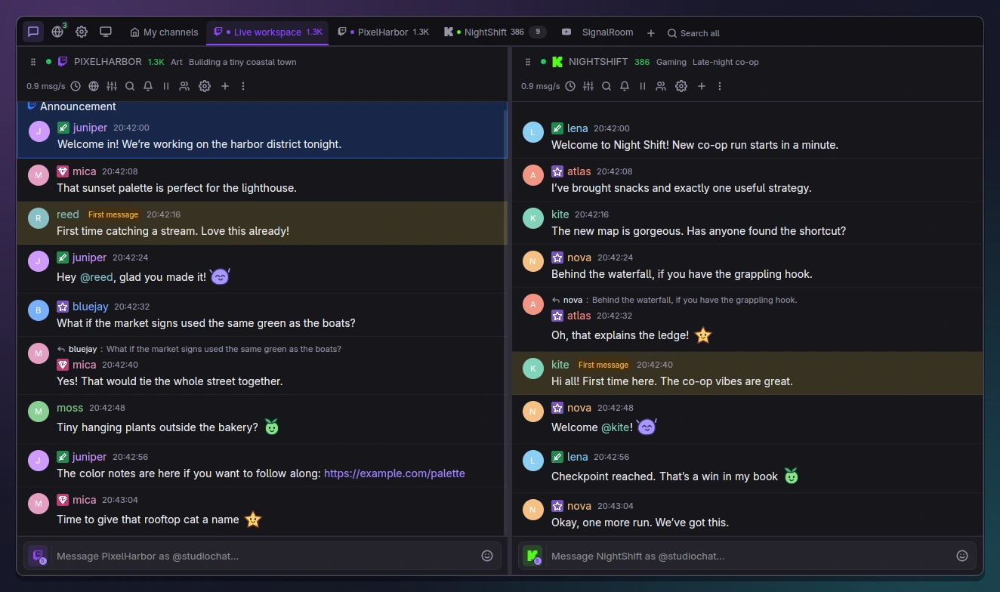
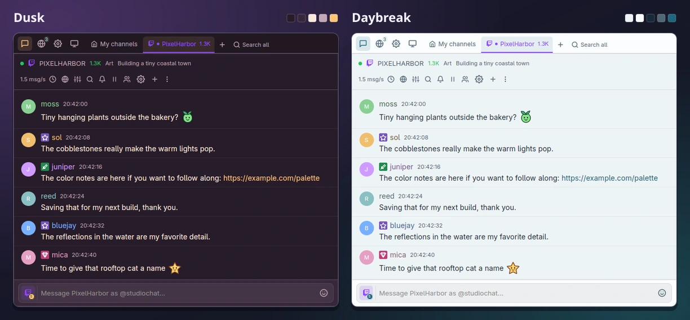

#  TwirChat

A desktop chat client for streamers, moderators, and viewers on Twitch, YouTube, and Kick.

**[Download TwirChat for Linux, Windows, or macOS](https://github.com/Satont/twirchat/releases/latest)**

_Twitch and Kick chats in a split workspace. Channels and messages are demo data._

## What you can do

- **Follow several chats at once.** Read your connected channels together in **My channels**, or open other channels in tabs and split panes. Use different saved Twitch or Kick accounts in different panes, even in the same chat.
- **Find what matters in a busy chat.** Set highlights, ignores, filters, and mention alerts. Search across open chats or look up and export saved history. Translate individual messages or set up automatic translation.
- **Make chat your own.** Use 7TV, BetterTTV, and FrankerFaceZ emotes alongside platform emotes, save favorites, and display 7TV name paints. Set your own keyboard shortcuts and commands. The interface is available in English and Russian.
- **Moderate and manage streams.** Delete messages, time out users, and ban users in Twitch and Kick chats where you have permission. Review held Twitch AutoMod messages inline and manage Twitch polls, predictions, and channel points rewards. Edit Twitch and Kick stream titles and categories.
- **Bring chat into your broadcast.** Add the **OBS overlay** as a browser source or use **OBS Remote** to switch scenes, adjust audio, and control streaming and recording. Show live DonationAlerts and DonatePay events in **My channels** and share them with viewers using TwirChat in your Twitch or Kick chat.

## Appearance

Open **Settings → General → Appearance** to try presets such as Ocean, Paper, Dracula, and
Catppuccin. Choose **Custom** under **Theme** and enter the five hex colors below to recreate
either example. The colors preview as you type. Select **Save changes** to keep the palette.

| Color      | Dusk      | Daybreak  |
| ---------- | --------- | --------- |
| Background | `#271c29` | `#eef4f7` |
| Surface    | `#38283a` | `#fbfdff` |
| Text       | `#fbe9db` | `#182b38` |
| Muted text | `#c0a8b5` | `#516675` |
| Accent     | `#ffc576` | `#1d677d` |

Open **Chat appearance** from the chat toolbar to switch between **Modern** and **Compact**
rows, change the font size, or toggle avatars, badges, and timestamps. The sample chat updates
as you change the options.

## Installation and updates

Download the package for your platform and `SHA256SUMS` from the
[latest release](https://github.com/Satont/twirchat/releases/latest).
Compare the package's SHA-256 checksum with its entry before running it.

| Platform                     | Package and requirements                                                                                                              |
| ---------------------------- | ------------------------------------------------------------------------------------------------------------------------------------- |
| Linux x64                    | Make the AppImage executable with `chmod +x` and run it. Requires glibc 2.35+, a Vulkan driver, and FUSE 2 for mounting where needed. |
| Windows x64                  | Run the Setup `.exe`. Use `Get-FileHash -Algorithm SHA256 <file>` to check it in PowerShell.                                          |
| macOS Apple Silicon or Intel | Run the matching `.pkg` or install `TwirChat.app` from the archive. Requires macOS 13+. Check with `shasum -a 256 <file>`.            |

On Linux, run `sha256sum --check --ignore-missing SHA256SUMS` in the download directory.
The [Linux install script](scripts/install-linux.sh) checks the AppImage and adds a launcher
to your application menu.

Packaged builds can download updates in the app and apply them on restart. Keep the Linux
AppImage in a writable directory for updates. If you're switching from the old desktop
distribution, back up `~/.twirchat` and install the current package manually once.
See the [release guide](docs/releasing.md#install-and-update) for package signing and update details.

## Clipboard image uploads

Open **Settings → Chat → Image Uploader** and sign in with Twir or configure a custom
multipart upload endpoint. You can also import a Chatterino, Leafyrino, or compatible ShareX
configuration. Paste a copied image with **Ctrl+V** or **Cmd+V** in the composer. TwirChat
asks before uploading by default and inserts the resulting link in your draft.

For a custom host, enter the multipart POST endpoint and file field. Add extra headers one per
line, or separate them with semicolons. If the server responds with JSON, use a template such as
`{data.images.0.url}` for **Image link**. Leave it blank for a plain URL response. You can use the
same template syntax for **Deletion link** and copy that link from the upload result.

## Plugins

Install extensions from a local manifest or HTTPS URL in **Settings → Plugins**. The
[plugin guide](docs/plugins.md) covers StreamX, custom commands, chat events, and channel transports.

## Development and self-hosting

- [Build and release guide](docs/releasing.md) for desktop builds, release packaging, and deploying the backend with Docker Compose and PostgreSQL.
- [Backend documentation](packages/backend/README.md) for configuration and local development.
- [Chat benchmarks](docs/benchmarks/README.md) for reproducing desktop CPU, GPU, and memory measurements.
