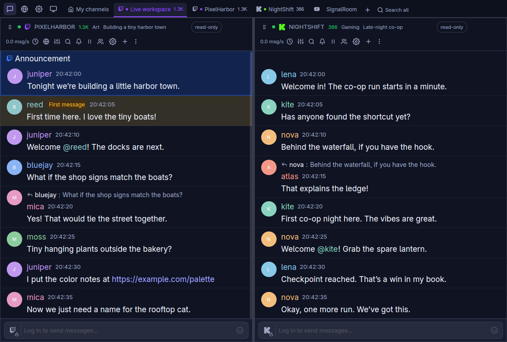
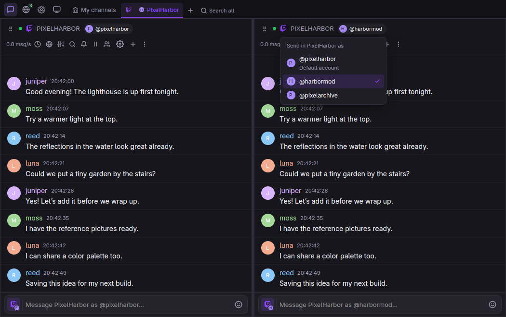
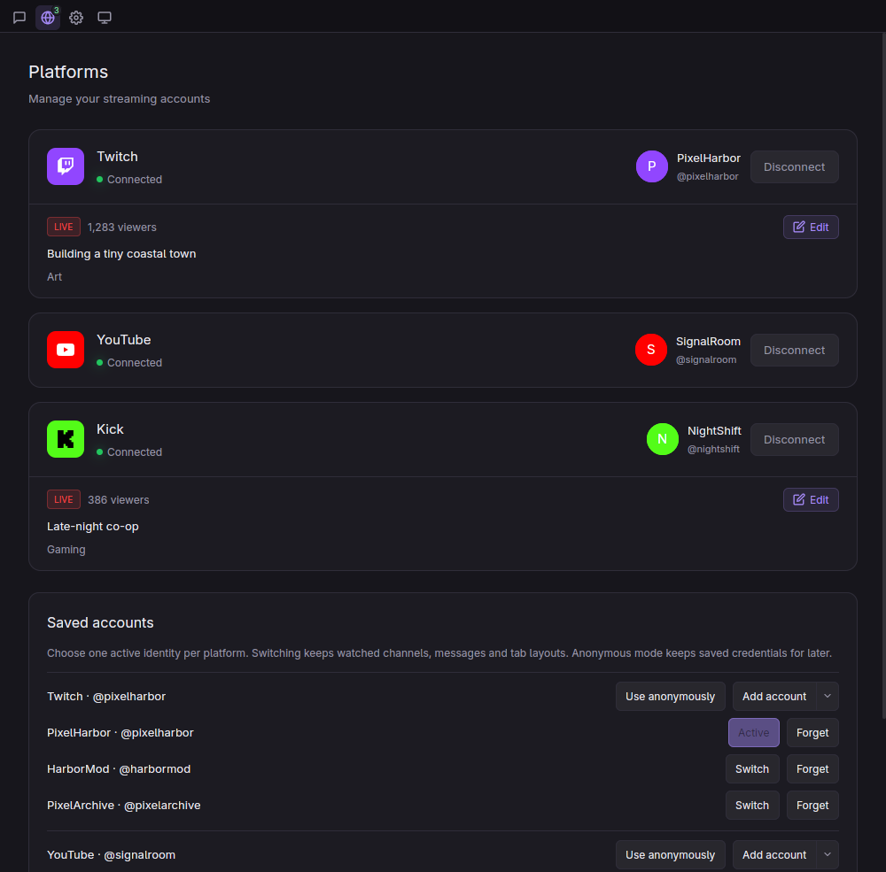
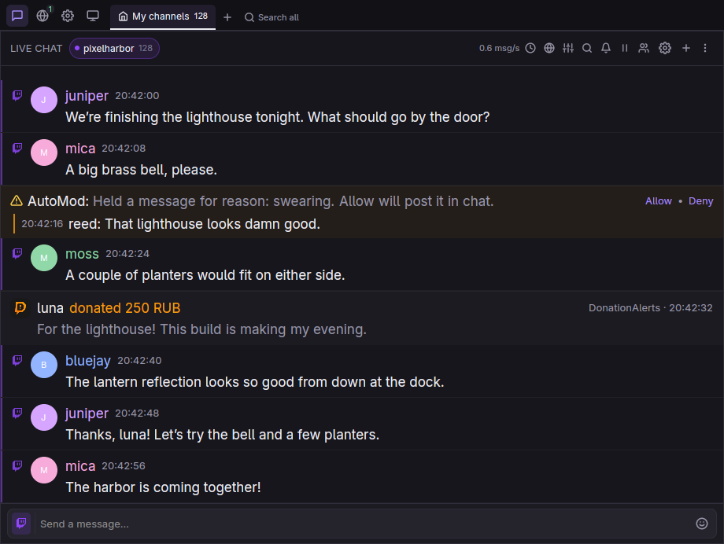
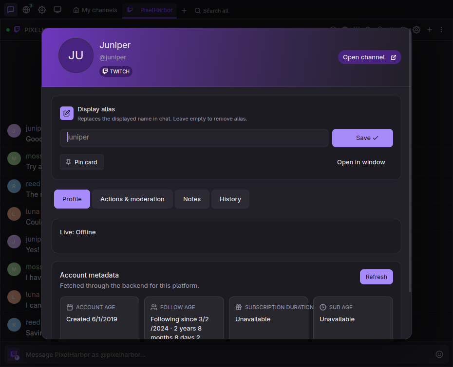
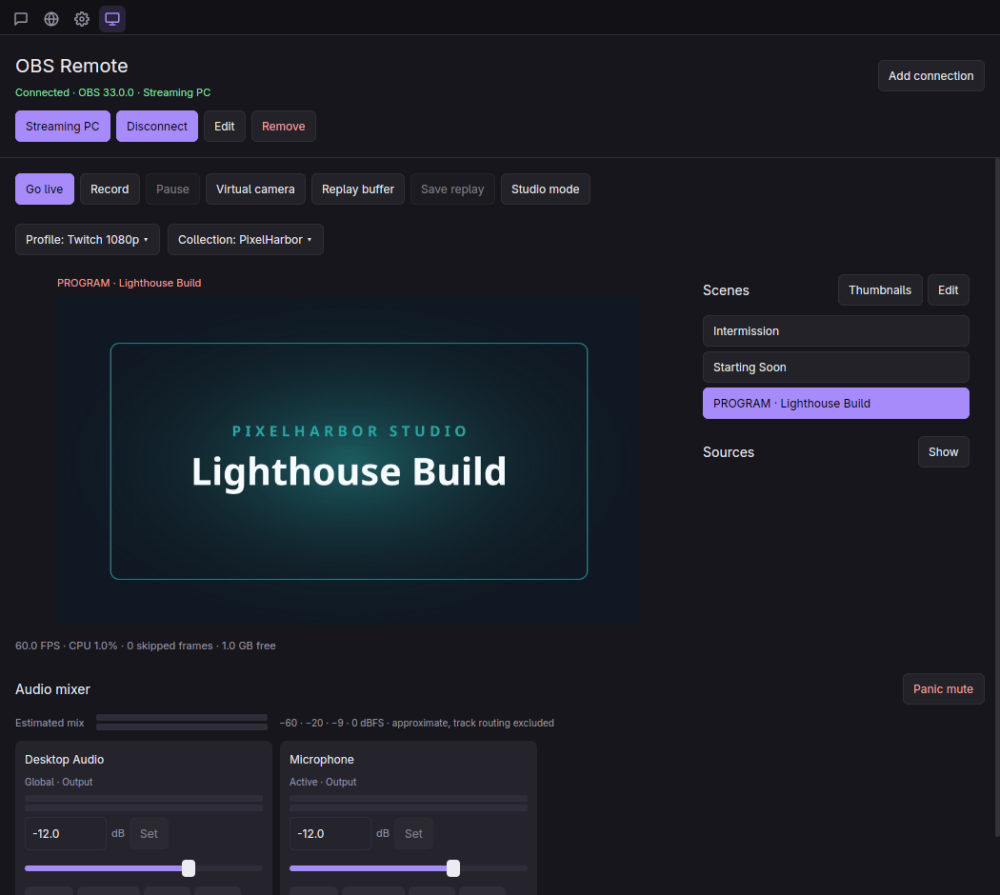
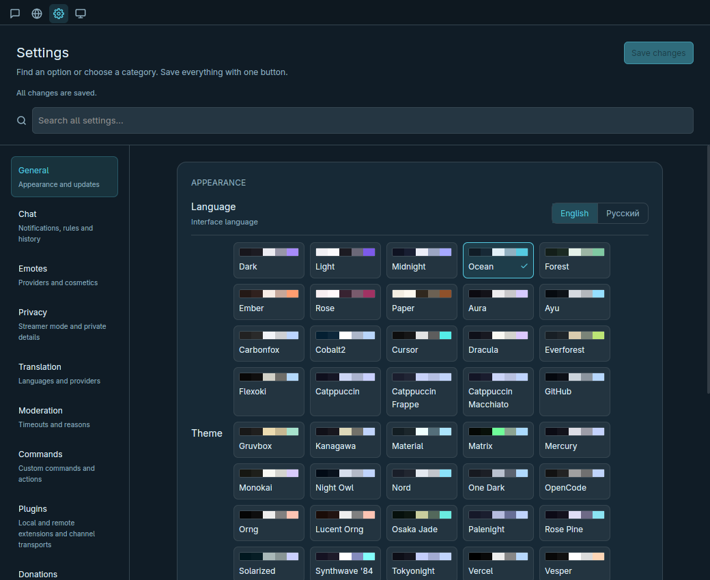
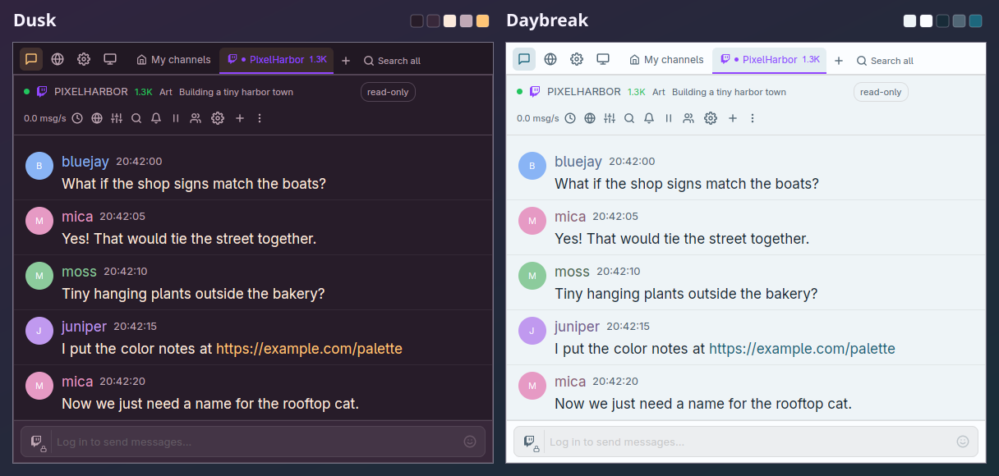

#  TwirChat

A desktop chat client for streamers, moderators, and viewers on Twitch, YouTube, Kick, and VK Play Live.

**[Download TwirChat for Linux, Windows, or macOS](https://github.com/Satont/twirchat/releases/latest)**

[Workspaces and accounts](#workspaces-and-accounts) · [Moderation and donations](#moderation-and-donations) ·
[OBS Remote](#obs-remote) · [Appearance](#appearance) ·
[Installation](#installation-and-updates)

_Screenshots show the TwirChat desktop app with demo channels, accounts, messages, donation events,
and OBS data._

## Workspaces and accounts

Read your connected Twitch, YouTube, and Kick channels together in **My channels**. Use tabs
and movable split panes to keep other chats open alongside them.

Add your accounts in **Platforms**. Open the same Twitch or Kick chat in two panes, then use
the account icon next to each message box to choose which saved account sends from that pane.
In the example below, the left pane sends as **@pixelharbor** and the right sends as **@harbormod**.

See saved accounts in Platforms

Use highlights, ignores, filters, and mention alerts to keep track of busy chats. Search across
open chats, export saved history, and translate individual messages or set up automatic
translation. The composer supports replies, emote and command completion, and custom commands.
TwirChat supports 7TV, BetterTTV, and FrankerFaceZ emotes alongside platform emotes, plus emote
favorites and 7TV name paints.

## Moderation and donations

Review Twitch AutoMod holds in the chat where they happened. With the required permissions,
select **Allow** or **Deny** directly in the held message's row. TwirChat also supports message
deletion, timeouts, and bans in Twitch and Kick.

Connect **DonationAlerts** or **DonatePay** in **Settings → Donations** to see donation alerts
among your messages in **My channels**. You can also share those alerts with viewers who use
TwirChat in your Twitch or Kick chat.

Click a username to open the user card. Check their profile or chat history, leave a note, or
use moderation actions for the current channel. You can pin the card or open it in a separate
window.

## OBS Remote

Use **OBS Remote** to switch scenes, show or hide sources, adjust audio, and control streaming
and recording through OBS WebSocket. To put chat on stream, copy the browser source URL from
**Settings → OBS overlay**.

From chat, you can also manage Twitch polls, predictions, and channel point rewards and edit
Twitch or Kick stream titles and categories.

## Appearance

Settings groups appearance, chat rules, notifications, privacy, shortcuts, and integrations in
one searchable screen. Choose English or Russian under **Appearance**.

Open **Settings → General → Appearance** to try presets such as Ocean, Paper, Dracula, and
Catppuccin. Choose **Custom** under **Theme** and enter the five hex colors below to recreate
either example. The colors preview as you type. Select **Save changes** to keep the palette.

| Color      | Dusk      | Daybreak  |
| ---------- | --------- | --------- |
| Background | `#271c29` | `#eef4f7` |
| Surface    | `#38283a` | `#fbfdff` |
| Text       | `#fbe9db` | `#182b38` |
| Muted text | `#c0a8b5` | `#516675` |
| Accent     | `#ffc576` | `#1d677d` |

Open **Chat appearance** from the chat toolbar to switch between **Modern** and **Compact**
rows, change the font size, or toggle avatars, badges, and timestamps. The sample chat updates
as you change the options.

## Installation and updates

Download the package for your platform and `SHA256SUMS` from the
[latest release](https://github.com/Satont/twirchat/releases/latest).
Compare the package's SHA-256 checksum with its entry before running it.

| Platform                     | Package and requirements                                                                                                              |
| ---------------------------- | ------------------------------------------------------------------------------------------------------------------------------------- |
| Linux x64                    | Make the AppImage executable with `chmod +x` and run it. Requires glibc 2.35+, a Vulkan driver, and FUSE 2 for mounting where needed. |
| Windows x64                  | Run the Setup `.exe`. Use `Get-FileHash -Algorithm SHA256 <file>` to check it in PowerShell.                                          |
| macOS Apple Silicon or Intel | Run the matching `.pkg` or install `TwirChat.app` from the archive. Requires macOS 13+. Check with `shasum -a 256 <file>`.            |

On Linux, run `sha256sum --check --ignore-missing SHA256SUMS` in the download directory.
The [Linux install script](scripts/install-linux.sh) checks the AppImage and adds a launcher
to your application menu.

Packaged builds can download updates in the app and apply them on restart. Keep the Linux
AppImage in a writable directory for updates. If you're switching from the old desktop
distribution, back up `~/.twirchat` and install the current package manually once.
See the [release guide](docs/releasing.md#install-and-update) for package signing and update details.

### Diagnostic logs

Release builds save diagnostic logs locally as `twirchat-*.log` files. TwirChat starts a fresh
file on launch and rotates at 5 MiB, retaining the five newest files. If an account disconnects,
the latest log can show whether authorization ended, a refresh failed, or an account was removed.

| Platform | Log directory                                                     |
| -------- | ----------------------------------------------------------------- |
| Linux    | `$XDG_STATE_HOME/twirchat/logs` or `~/.local/state/twirchat/logs` |
| Windows  | `%LOCALAPPDATA%\TwirChat\logs`                                    |
| macOS    | `~/Library/Logs/TwirChat`                                         |

## Clipboard image uploads

Open **Settings → Chat → Image Uploader** and sign in with Twir or configure a custom
multipart upload endpoint. You can also import a Chatterino, Leafyrino, or compatible ShareX
configuration. Paste a copied image with **Ctrl+V** or **Cmd+V** in the composer. TwirChat
asks before uploading by default and inserts the resulting link in your draft.

For a custom host, enter the multipart POST endpoint and file field. Add extra headers one per
line, or separate them with semicolons. If the server responds with JSON, use a template such as
`{data.images.0.url}` for **Image link**. Leave it blank for a plain URL response. You can use the
same template syntax for **Deletion link** and copy that link from the upload result.

## Plugins

Install extensions from a local manifest or HTTPS URL in **Settings → Plugins**. The
[plugin guide](docs/plugins.md) covers StreamX, custom commands, chat events, and channel transports.

## Development and self-hosting

- [Build and release guide](docs/releasing.md) for desktop builds, release packaging, and deploying the backend with Docker Compose and PostgreSQL.
- [Backend documentation](packages/backend/README.md) for configuration and local development.
- [Chat benchmarks](docs/benchmarks/README.md) for reproducing desktop CPU, GPU, and memory measurements.
