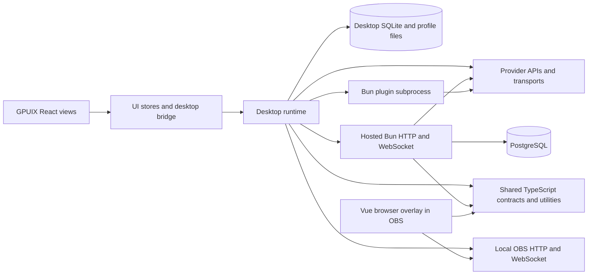

# TwirChat architecture

TwirChat is a desktop client for viewers, streamers, and moderators. It reads and sends chat across Twitch, YouTube, Kick, VK Play Live, and installed plugin transports. Workspaces, moderation, donations, OBS control, and the OBS browser overlay are different views or consumers of that runtime. The hosted backend supports provider operations that need a public endpoint, confidential credentials, or a connection shared across clients. It does not render the desktop or own its workspaces.

## Dependency and runtime map

Arrows show calls, protocol dependencies, or imports, not the direction of every event. The desktop and hosted packages import shared code through `@twirchat/shared` exports, not filesystem paths. They do not import each other, and shared does not import either app. Oxlint checks this direction for literal JS/TS import specifiers, including type imports, re-exports, and dynamic imports. The rule checks known workspace paths and aliases; it is not a general runtime module resolver. The same rule keeps GPUIX presentation from directly importing desktop persistence stores or platform adapters. Desktop source outside `src/gpuix` cannot import that application tree, including its types; framework-independent contracts live with their features. This restriction does not cover external GPUIX packages or QA harnesses. The repository-wide `import/no-cycle` check also counts type dependencies. Repository-level integration tests and plugin examples are outside the workspace rule. The browser overlay is built from the desktop workspace, but runs outside the native process. Plugins are separate processes, not a security sandbox.

| Area                                      | Entry or public seam                                                                                                                                                                                                                             | Owns                                                                                                                                                                                                                                                                                                                                             |
| ----------------------------------------- | ------------------------------------------------------------------------------------------------------------------------------------------------------------------------------------------------------------------------------------------------ | ------------------------------------------------------------------------------------------------------------------------------------------------------------------------------------------------------------------------------------------------------------------------------------------------------------------------------------------------ |
| Native desktop and lifecycle              | [`gpuix/main.tsx`](../packages/desktop/src/gpuix/main.tsx), [`getDesktopBackend`](../packages/desktop/src/gpuix/backend/server.ts)                                                                                                               | Native windows and runtime composition. The runtime survives development HMR; React roots and their handlers can remount without reconnecting.                                                                                                                                                                                                   |
| Desktop UI and design system              | [`gpuix/components`](../packages/desktop/src/gpuix/components), [`theme.ts`](../packages/desktop/src/gpuix/theme.ts), [`i18n`](../packages/desktop/src/i18n)                                                                                     | GPUIX primitives, theme, localized presentation and interactions. Services use framework-independent localization; React hooks adapt the same language state. [`DesktopApi`](../packages/desktop/src/gpuix/backend/api.ts) and [`DesktopEventMap`](../packages/desktop/src/gpuix/backend/events.ts) are the in-process UI seam, not network RPC. |
| Desktop live view state                   | [`state/app.ts`](../packages/desktop/src/gpuix/state/app.ts), [`state/layout-state.ts`](../packages/desktop/src/gpuix/state/layout-state.ts), [`state/chat-tabs.ts`](../packages/desktop/src/gpuix/state/chat-tabs.ts)                           | Renderable projections, panes/tabs, visible messages and interactions. [`create-store.ts`](../packages/desktop/src/state/create-store.ts) defers React notifications to avoid native reentrancy.                                                                                                                                                 |
| Desktop durable state                     | [`desktop/src/store`](../packages/desktop/src/store), [`layout-api.ts`](../packages/desktop/src/gpuix/backend/layout-api.ts)                                                                                                                     | SQLite accounts, settings, layouts, and local chat history; profile files for runtime assets and installed plugins. UI stores do not replace persisted state as the authority.                                                                                                                                                                   |
| Desktop chat                              | [`platforms`](../packages/desktop/src/platforms), [`chat/aggregator.ts`](../packages/desktop/src/chat/aggregator.ts), [`watched-channels`](../packages/desktop/src/watched-channels)                                                             | Connections, provider-to-chat normalization, watched channel lifecycle, enrichment and deduplication. Signed-in YouTube chat uses direct gRPC; anonymous YouTube chat uses the hosted gRPC relay.                                                                                                                                                |
| Desktop identity and service access       | [`auth`](../packages/desktop/src/auth), [`runtime-config.ts`](../packages/desktop/src/runtime-config.ts), [`backend-connection.ts`](../packages/desktop/src/backend-connection.ts)                                                               | Desktop sign-in and callback handling, authenticated backend HTTP requests, and the backend WebSocket. Kick delegates confidential OAuth operations to the hosted server. Provider tokens and `X-Client-Secret` are different credentials.                                                                                                       |
| Desktop integrations                      | [`desktop/src/donations`](../packages/desktop/src/donations), [`desktop/src/services`](../packages/desktop/src/services), [`plugins/api.ts`](../packages/desktop/src/plugins/api.ts)                                                             | Donation and OBS Remote clients, external services and local caches, plus plugin lifecycle and host API. Installed plugins can provide commands and transports; StreamX is a tracked plugin.                                                                                                                                                     |
| OBS overlay                               | [`overlay-server.ts`](../packages/desktop/src/overlay-server.ts), [`views/overlay`](../packages/desktop/src/views/overlay)                                                                                                                       | Local `Bun.serve` serves built Vue assets and pushes chat over WebSocket. Overlay URL preferences and rendering are separate from GPUIX settings/components. OBS Remote instead controls OBS via its WebSocket API.                                                                                                                              |
| Hosted HTTP, WebSocket, and configuration | [`backend/src/index.ts`](../packages/backend/src/index.ts), [`routes`](../packages/backend/src/routes), [`ws`](../packages/backend/src/ws), [`config.ts`](../packages/backend/src/config.ts)                                                     | HTTP routing, startup/shutdown, request validation, ephemeral client connections and subscription/fan-out state. Config is parsed at startup.                                                                                                                                                                                                    |
| Hosted persistence and providers          | [`db/store.ts`](../packages/backend/src/db/store.ts), [`db/migrations.ts`](../packages/backend/src/db/migrations.ts), [`api`](../packages/backend/src/api), [`auth`](../packages/backend/src/auth), [`youtube`](../packages/backend/src/youtube) | PostgreSQL client/account records and legacy Kick sessions; upstream provider calls, webhooks, metadata and cache policy, history and anonymous YouTube relay.                                                                                                                                                                                   |
| Shared contracts                          | [`shared/types.ts`](../packages/shared/types.ts), [`shared/protocol.ts`](../packages/shared/protocol.ts), [`shared/youtube`](../packages/shared/youtube)                                                                                         | Normalized chat and settings types, validated desktop↔hosted wire messages, schema/codegen and shared gRPC session logic. Feature contracts use explicit subpath imports.                                                                                                                                                                        |

## Constraints and historical decisions

- **Native vs. browser:** GPUIX replaced the old webview shell; the in-process API/events still separate UI and runtime. OBS browser sources still need HTML, so they use Vue/Vite. Do not restore webview assumptions to GPUIX.
- **Process vs. view lifetime:** HMR must not drop accounts, chat connections or pending writes. Resource cleanup on application exit is a separate contract. New resources need an explicit owner and lifetime.
- **Persisted vs. on-wire compatibility:** The SQLite profile and PostgreSQL account migrations support older data; hosted endpoints can have older desktop callers. Audit real callers before removing routes, fields, migrations, or preference translations.
- **Native provenance:** [`native/gpuix/source.json`](../packages/desktop/native/gpuix/source.json) pins upstream GPUIX/GPUI revisions, Rust toolchain, and patch checksums. [`build-gpuix-native.ts`](../packages/desktop/scripts/build-gpuix-native.ts) prepares and builds that source; packaged runtimes carry a native manifest. See the [release guide](releasing.md).
- **Validation:** Root `bun run check` runs quality-rule fixtures, typechecks, lint, and format. `bun run test` runs workspace suites. [CI validation](../.github/workflows/validation.yml) adds codegen, release assets, deployment configuration and isolated PostgreSQL coverage. [Desktop builds](../.github/workflows/desktop-build.yml) include a packaged GUI smoke test. Native interaction QA must use the isolated launcher; changes to desktop hot paths require [performance evidence](benchmarks/README.md).

See the [refactoring log and backlog](architecture-progress.md) for scoped decisions, known exceptions, and next investigations.
