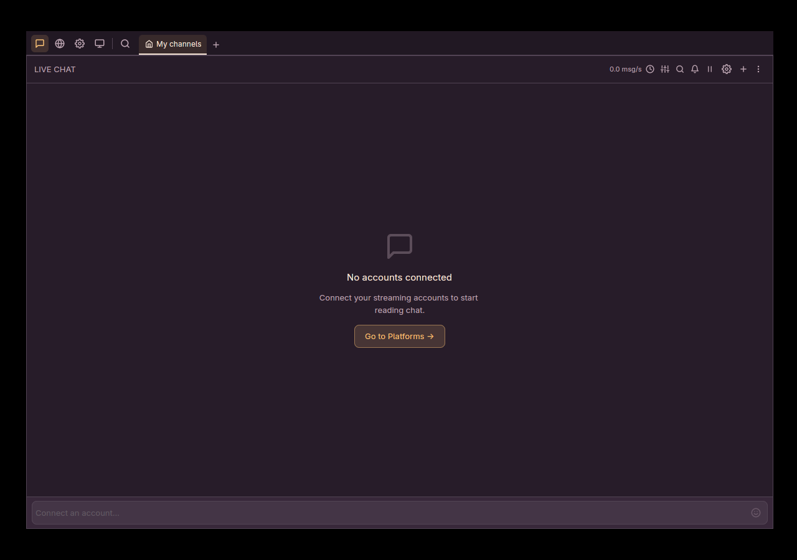
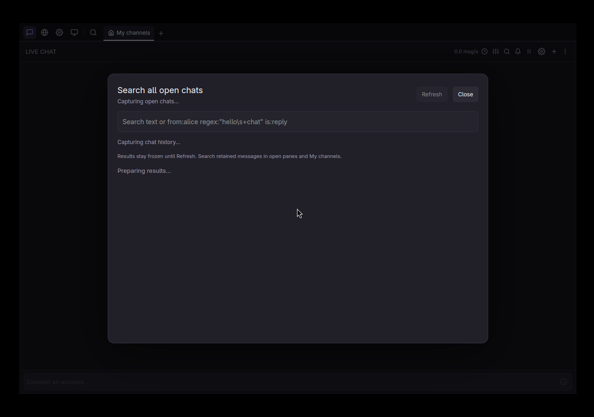

# Header Search all action

`Search all` moved from the channel tab row into the main navigation. It now sits to the right of
OBS Remote, separated by a divider, and is rendered as an icon without text. The tab row's
`Restore` action is removed.

The real production-style app was driven through the isolated GUI QA launcher at 1280×900. It
opened `Search all` from the new `nav-search-all` button, closed it with Escape, verified the
navigation order and divider bounds, and checked that neither `tab-search-all` nor `tab-restore`
remains in the tab row.

## Checks

- `bun run fix`, `bun run check`, `bun run test`: passed.
- `qa:app` passed on a private virtual display, including the navigation-order assertions and the
  Search all dialog open/close flow.
- The focused tab-counter QA (`qa-tab-counts`) still fails on unmodified `main` at
  `tab-a resized in compact at 61500`; this branch reproduces the same unrelated failure.
