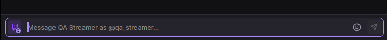
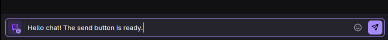
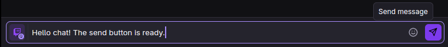

# Composer send button

The message composer now has a paper-plane send button at the right edge of the input row, next to
the emote picker. It is enabled when the draft is non-empty and at least one selected target can
accept it, including a reply to the same platform. It dims when the draft is empty, no compatible
target is connected, the message exceeds the platform limit, or another send is already being
prepared.

A click, or Enter/Space while the button is focused, runs the same send pipeline as the Enter key —
including commands, translation previews and custom commands — and then returns focus to the
textarea. The control has button semantics, a localized accessible name, and a localized tooltip in
English and Russian.

## Checks

- `bun run check` — passed.
- `bun run test` — passed: desktop 1345 tests pass with 12 skipped; backend 133 tests pass with 15
  skipped.
- `bun run qa:gui --timeout 60 -- bun tests/composer-frame-qa.tsx` — passed on a private virtual
  display, including native Enter and button sends, reply-target compatibility, target routing,
  focus return, and layout containment at wide and compact window sizes.
- `qa:composer` was attempted, but it stops earlier at the existing `keepInput sends` timeout. The
  same failure occurs on unmodified `main` at `6b421f8`.
