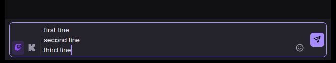
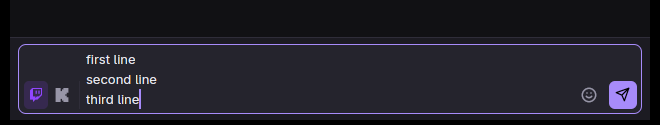
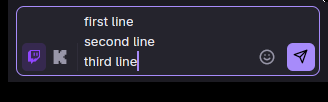

# Composer send button alignment

The composer send button was anchored to the first line of a multi-line draft while the emote
button stayed at the bottom. GPUIX's `Tooltip` renders its own flex wrapper, and that wrapper — not
the button inside it — is the flex item in the composer row. The inner `alignSelf: flex-end` could
not move the wrapper, so the button drifted up as the textarea grew.

The fix applies the bottom alignment to the tooltip wrapper itself
(`alignSelf: flex-end`, `flexShrink: 0`). Both controls now stay on the same bottom row at every
composer height.

## Before

The send button sits at the top of a three-line composer while the emote button is at the bottom.

## After

The send button shares the bottom row with the emote button.

## Checks

- `bun run check` — passed.
- `bun run test` — passed: desktop 1390 tests pass with 12 skipped; backend 133 tests pass with 15
  skipped; shared 27 tests pass.
- `bun run qa:gui --timeout 60 -- bun tests/composer-frame-qa.tsx` — passed on a private virtual
  display. The fixture now types a three-line draft and asserts that the bottom edges of the send
  and emote buttons match at both compact and wide window sizes. The same assertion fails without
  the fix.
