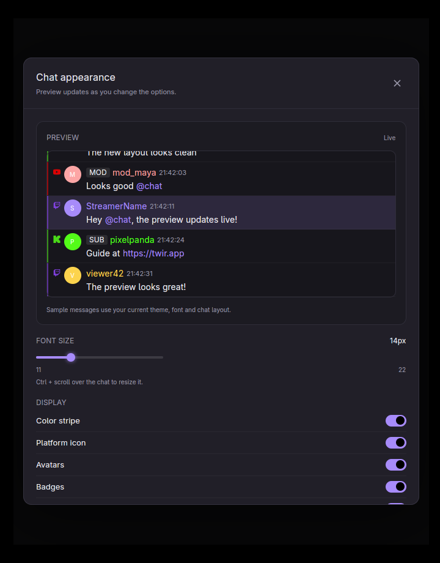
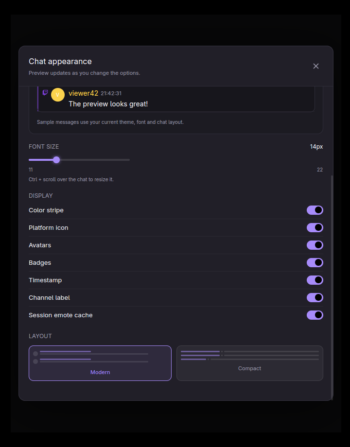
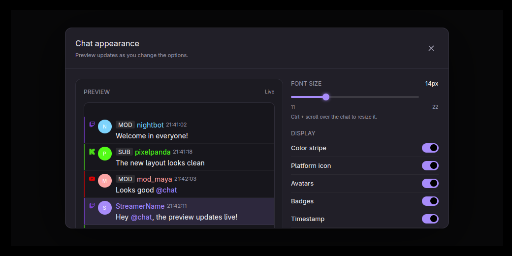
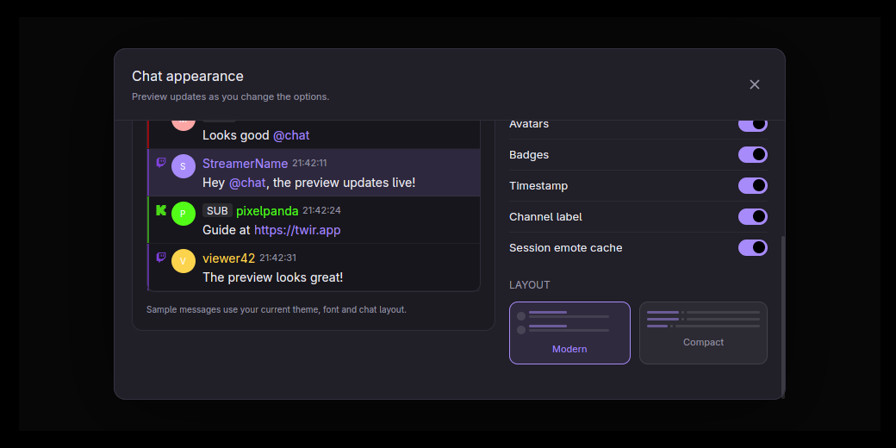

# Chat appearance scrolling in short windows

The chat appearance dialog is taller than a short window. Two layout problems kept the bottom of
the settings unreachable:

1. The content pane declared `overflowY: 'auto'`. GPUIX only recognises `overflowY: 'scroll'` as a
   native scroll container, so the pane had no viewport and the wheel gesture fell through to the
   chat preview instead.
2. In the normal-width row layout the flex children were stretched to the viewport height. The
   settings column then overflowed its own box without contributing to the scroll extent, so even
   a working scroller stopped after a few pixels. The row is now top-aligned
   (`alignItems: 'flex-start'`) so the natural settings height defines the scrollable content.

The dialog body is a themed native scroll container; the header stays fixed and both the column
(narrow) and row (normal) layouts scroll.

## Narrow window — 680×860

| Before: options clipped, no scrollbar       | After: scrolled to the Layout cards        |
| ------------------------------------------- | ------------------------------------------ |
|  |  |

## Normal-width window — 1000×480

The row layout still overflows vertically because the dialog height is capped at 85% of the window.

| Before: options clipped at the Timestamp row | After: scrolled to the Layout cards        |
| -------------------------------------------- | ------------------------------------------ |
|   |  |

All captures use the isolated GUI QA launcher. The before runs scrolled the wheel sixteen times
over the settings column and measured `getScrollOffset() === 0`; the after runs report `-255`
(narrow) and `-229` (normal) and bring the `Modern`/`Compact` cards into view. The normal-width run
also asserts that the Layout cards sit in the right-hand column, so it exercises the row branch.

## Checks

- `bun run qa:gui --display-width 720 --display-height 920 --timeout 60 -- bun
  scripts/qa-chat-appearance.tsx` — passed: narrow column layout, offset `-255`.
- `bun run qa:gui --display-width 1040 --display-height 520 --timeout 60 -- bun
  scripts/qa-chat-appearance.tsx --normal` — passed: normal row layout, offset `-229`.
- The same commands with `--before` against the old `overflowY: 'auto'` — passed: offset `0`, Layout
  cards remain clipped in both layouts.
