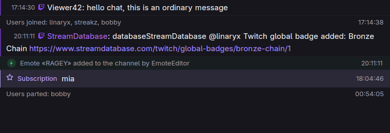
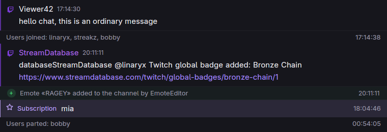
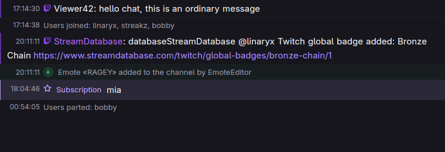
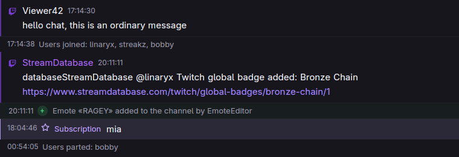

# Event row timestamps

Message timestamps occupy a fixed, right-aligned column at the start of each compact chat row.
Event rows — Twitch join/part membership notices, subscription/raid/bits notices and 7TV system
messages — rendered their time at the end of the row instead. The time moved with the row width,
did not line up with the chat around it, and was easy to miss next to wrapped text.

`EventTimestamp` now leads notice and system rows. In the compact layout it reuses
`timestampColumnWidth` and `timestampSize`, so event times share the message timestamp column and
stay aligned when a notice wraps. The modern layout puts the event time before the notice icon and
summary as well.

## Before

Compact: event times sit at the far right while messages use the left column.

Modern: event times are also right-aligned.

## After

Compact: join, part, subscription and 7TV system times share the message timestamp column.

Modern: event times lead the row.

## Checks

- `bun run fix` — passed; no new lint errors.
- `bun run check` — passed (desktop, backend and shared typechecks, lint and formatting).
- `bun run test` — passed: desktop 1406 pass / 12 skip, backend 133 pass / 15 skip, shared 32
  pass, root quality and donation OAuth scripts 39 pass.
- `bun run --cwd packages/desktop qa:chat-events` — isolated native GUI QA at 760×260. It renders
  compact and modern rows, then asserts that join, subscription and 7TV event times precede their
  text and that compact event times start at the same x as ordinary message timestamps. The
  fixture fails on the previous revision because the leading event timestamp nodes do not exist,
  and passes with this change.

Rendering-only change limited to event rows. Ordinary message rows, ingestion, stores and the
benchmark workload are untouched; the completed
[membership benchmark](../benchmarks/2026-11-14-twitch-chat-membership/report.md) remains valid
for that workload.
