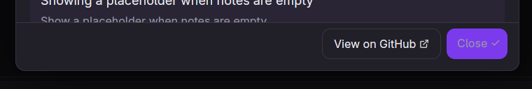
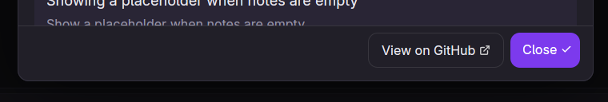

# Changelog dialog Close button label contrast

The changelog dialog that greets every updated install paints its **Close**
action on the deep accent fill. The label and the check glyph inside it used
`theme.text2` — the muted secondary color that `deriveTheme` tunes for _dialog
and background surfaces_, never for accent fills. The measured contrast:

| Theme          | Label     | Button fill | Contrast |
| -------------- | --------- | ----------- | -------- |
| Dark (default) | `#9896a8` | `#7c3aed`   | ≈ 2:1    |
| Light          | `#6b6878` | `#7c3aed`   | ≈ 1.1:1  |

WCAG AA requires 4.5:1, so the label was unreadable at a glance — on the light
theme effectively invisible. Every other accent-deep surface in the app already
uses the dedicated `theme.accent.onDeep` token (`AddChannelForm`, `UserCardUI`,
`UserNotes`), which `deriveTheme` resolves to black or white per fill luminance.
The Close button now does the same for both the label and the check icon, so
the fix holds for every preset and custom palette.

| Before: muted label, 0 AA pixels              | After: onDeep label, 124 AA pixels        |
| --------------------------------------------- | ----------------------------------------- |
|  |  |

Both captures come from the isolated GUI QA launcher (`qa:changelog`) on the
private Xvfb display, cropped to the modal footer.

## Regression guard

`qa-changelog.tsx` now samples the Close button rect from the private
framebuffer, resolves the button fill as the modal color bucket, and fails when
fewer than 30 pixels reach the 4.5:1 AA contrast against it:

- before the fix: `0` AA pixels, best contrast `2.73:1`
- after the fix: `124` AA pixels, best contrast `5.95:1`

The same refresh realigns two stale painted-text asserts with the current
modal: the header line changed to `Version v1.7.1 - November 8, 2026` in #256,
and per-item `NEW`/`FIXED` badges no longer exist — section headings are the
coverage guard now.

## Checks

- `bun run qa:changelog` — passed on its private virtual display; the pre-fix
  run failed on the legibility assert with the numbers above.
- `bun run typecheck` — passed (all four project configs).
- `bun test tests/` — 1479 pass, 0 fail.
