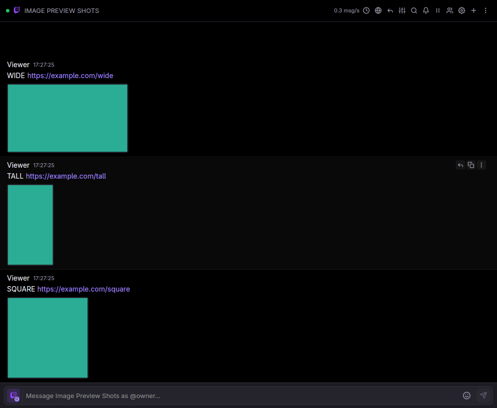
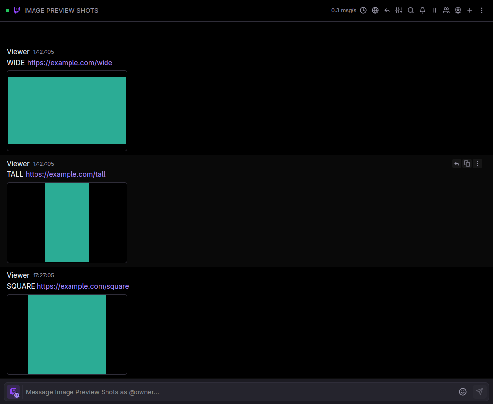

# Fixed chat image preview slot

Inline link previews used to size their card to the generated thumbnail, so a wide, tall or
square image produced a different card and shifted the chat row.

Every preview now renders into one 240×160 slot (244×164 including the 1px padding and border).
The image is fitted inside the slot and a differing aspect ratio is letterboxed on black instead
of resizing the card.

## Before

Wide, tall and square images produce cards of three different sizes.

## After

The same three images share the fixed slot; the leftover space is black.

## Checks

- `bun run fix`, `bun run check`, `bun run test`: passed.
- The isolated GUI QA launcher at 1280×900 rendered one wide, one tall and one square preview and
  captured both screenshots.
- `qa-chat-image-preview` asserts that a wide and a tall preview keep identical 244×164 bounds.
